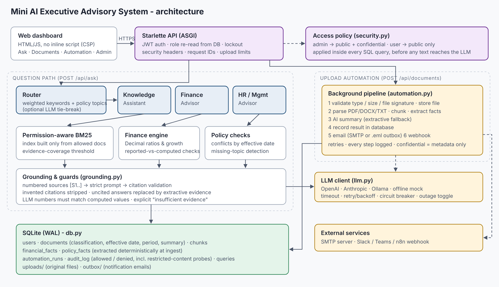

# Mini AI Executive Advisory System

A working prototype that lets a company upload business documents (PDF, Word, text) and ask
questions about them. Each question is routed to one of three assistants:

| Assistant | What it does |
|---|---|
| **Knowledge Assistant** | Answers from the uploaded documents, cites every source `[S1]` (document, page, excerpt), and says *"I cannot find sufficient evidence"* when the documents don't cover the question. |
| **Finance Advisor** | Pulls figures from finance documents, **computes ratios, margins, growth and budget variance in Python (`Decimal`)**, checks reported figures against their inputs, and writes a short analysis backed by evidence. |
| **HR / Management Advisor** | Answers policy questions from HR documents, **flags conflicting policies** (with effective dates), and **lists missing information**. |

Access is enforced by role: **Administrator** sees public and confidential documents, while a **Standard User**
sees only public ones. The filter is applied in the database query, before any text reaches the
AI. Every upload triggers an **automation pipeline**: parse, then summarise, then store in the database, then
send an email notification, then call a webhook.



---

## Quick start (about 5 minutes, no API key needed)

Requires **Python 3.10+** and **Git**. Tested on Windows (Python 3.14) and Linux (Python 3.13).

**Windows (PowerShell / VS Code terminal)**
```powershell
git clone https://github.com/usmanahmadcs/exec-advisor.git
cd exec-advisor
py -m venv .venv
.venv\Scripts\activate
pip install -r requirements-dev.txt
copy .env.example .env
py scripts/seed_demo.py --reset        # creates users + loads 8 sample documents
py -m advisor.app                      # then open http://127.0.0.1:8000
```

**macOS / Linux**
```bash
git clone https://github.com/usmanahmadcs/exec-advisor.git
cd exec-advisor
python3 -m venv .venv && source .venv/bin/activate
pip install -r requirements-dev.txt
cp .env.example .env
python scripts/seed_demo.py --reset
python -m advisor.app                  # then open http://127.0.0.1:8000
```

> Windows tips: if `python` says *"Python was not found"*, use `py` as shown above. If activation says
> *"running scripts is disabled"*, run `Set-ExecutionPolicy -Scope CurrentUser RemoteSigned` once.

Sign in with a demo account (change these in `.env` before any real use):

| Role | Username | Password |
|---|---|---|
| Administrator | `admin` | `Admin#2026!` |
| Standard user | `analyst` | `Analyst#2026!` |

The **Ask** tab has one-click example questions covering every scenario in the brief.

### Using a real language model

The default `LLM_PROVIDER=mock` runs fully offline. In that mode answers are **extractive**: they quote the
relevant source sentences, and finance answers come from deterministic code. To get generated answers,
set one of the following in `.env` and restart:

```bash
LLM_PROVIDER=openai     OPENAI_API_KEY=sk-...        # optional: LLM_MODEL=gpt-4o-mini
LLM_PROVIDER=anthropic  ANTHROPIC_API_KEY=sk-ant-... # optional: LLM_MODEL=claude-haiku-5-5
LLM_PROVIDER=ollama     OLLAMA_URL=http://localhost:11434  LLM_MODEL=llama3.1:8b
```

`OPENAI_BASE_URL` also lets you use Azure OpenAI, vLLM, LM Studio or any other OpenAI-compatible server. Check the model
names your account has access to and set `LLM_MODEL` if a default isn't available.

### Docker

```bash
cp .env.example .env
docker compose up --build -d
docker compose exec advisor python scripts/seed_demo.py
# open http://127.0.0.1:8000
```

### Tests

```bash
python -m unittest discover -s tests -t . -v      # Windows: py -m unittest discover -s tests -t . -v
```

47 tests run offline in under 30 seconds (messages such as `webhook attempt 1/3 failed` are expected:
those tests deliberately simulate outages). `tests/test_reliability.py` maps directly to Task 3 and Task 6 (see below).

---

## How each requirement is met

### Task 1: AI Knowledge Assistant
* Upload **PDF / DOCX / TXT / MD** in the *Documents* tab (`POST /api/documents`). Files are checked against an
  extension allow-list, a size limit and their **file signature** (a `.pdf` must really be a PDF).
* Text is extracted with page numbers (PDF), and Word **tables are kept as rows**. It is then split into
  paragraph-aware chunks that never cross a page boundary, so every citation points to an exact page.
* Retrieval uses **BM25** with business synonyms (CEO → chief executive officer, and so on).
* Every answer lists its sources: `[S1]`, document title, file, page, effective date and an excerpt.
* **Insufficient evidence**: the system measures how much of the question's *specific* vocabulary
  (IDF-weighted) appears in the retrieved evidence. If coverage is below `MIN_EVIDENCE_COVERAGE`, or the LLM
  answers `INSUFFICIENT_EVIDENCE`, or the LLM answer has no valid citation, the user gets an explicit
  "cannot find sufficient evidence" message instead of a guess.

### Task 2: Two specialist advisors and automatic routing
* **Router** (`advisor/router.py`): a transparent weighted-keyword classifier. The UI shows which words
  triggered the route. Recognised HR policy topics also route to HR, and when a real LLM is configured it
  breaks ties in ambiguous cases. You can override the route with the advisor dropdown.
* **Finance Advisor** (`advisor/finance.py`):
  * At ingest, figures such as `Revenue: AED 4,200,000` or table rows are extracted into
    `financial_facts` by rules, not by the LLM.
  * It computes gross, operating and net margin, the opex ratio, revenue against budget, and period-on-period
    growth with `Decimal` arithmetic. Each result shows its formula, inputs and source document.
  * It **verifies reported figures**: gross profit = revenue − COGS, total opex = sum of its line items,
    operating profit = gross profit − opex. The sample Q2 report states operating profit wrongly on purpose,
    and the system detects it.
  * If an LLM writes the narrative, **every number in it is checked** against source and computed values.
    A narrative containing an unverified figure is discarded and replaced by the code-generated analysis.
* **HR / Management Advisor** (`advisor/advisors.py`, `advisor/facts.py`):
  * Policy parameters such as annual leave, probation, notice period, remote work and sick leave are
    extracted into `policy_facts`.
  * **Conflicts**: when documents give different values for the same topic, both are shown with their
    sources. The newer effective date is suggested as the one that prevails. If dates are missing, the
    conflict is escalated to HR.
  * **Missing information**: a policy topic that no accessible document covers is reported as missing.

### Task 3: Security and access control
* Two roles, `admin` and `user`. Passwords use PBKDF2-SHA256 with 240k iterations and a salt. Accounts
  lock after 5 failed logins. Sessions use signed JWTs, and the role is **re-read from the database on every request**,
  so editing the token's role claim does nothing.
* `allowed_classifications(role)` is applied **inside the SQL** for document lists, downloads, retrieval,
  financial facts, policy facts, summaries and automation logs. Confidential chunks are never indexed for a
  standard user, so they can't be retrieved, quoted, summarised or sent to the LLM, even through prompt injection.
* A request for a restricted document returns **404, not 403**, so the response doesn't confirm the document exists.
* **Monitoring**: when a standard user's question matches confidential content, the user gets the normal
  "insufficient evidence" answer and an audit event `restricted_content_request / denied` is written for
  administrators.
* Standard users can't upload confidential files, delete documents or call admin endpoints. All of these
  attempts are audited.
* Confidential documents' email and webhook notifications contain **metadata only**, never the summary.
* The dashboard inserts all document text with `textContent` (no XSS). A strict Content-Security-Policy
  blocks inline script.

### Task 4: Business automation and integration
Each upload triggers a background pipeline (`advisor/automation.py`). Every step is recorded in
`automation_runs` and shown in the *Automation* tab:

1. **parse_and_index**: extract text, chunk it, extract finance and policy facts
2. **summarise**: LLM summary, with an extractive fallback
3. **record_in_database**: store the summary on the document record (SQLite)
4. **email_notification**: SMTP when `SMTP_HOST` is set. Otherwise a real `.eml` file is written to
   `data/outbox/`, which you can view in *Admin › Notification outbox*.
5. **webhook**: JSON POST to `WEBHOOK_URL` (Slack/Teams incoming webhook, n8n, Zapier, Make)

External steps retry with exponential backoff. A failing email or webhook is logged as `failed` but never loses the
document. A file that can't be parsed marks the document `failed`, records the reason and sends a failure
notification.

### Task 5: UI and deployment
* Dashboard at `/`: **Ask**, **Documents**, **Automation**, and **Admin & Security** (metrics, audit log,
  question log, outbox, outage simulator).
* JSON API under `/api/*` (see `advisor/app.py`), health check at `/api/health`.
* Deployment, monitoring, maintenance and expansion are covered in **[docs/DEPLOYMENT.md](docs/DEPLOYMENT.md)**.

### Task 6: Reliability and testing

| Scenario | How it is handled | Test (`tests/test_reliability.py`) | Try it in the UI |
|---|---|---|---|
| Missing information | evidence-coverage threshold, missing policy topic, unavailable period or metric | `TestMissingInformation` | "How many days of parental leave…", "What was Q3 2026 revenue?" |
| Conflicting information | policy conflicts resolved by effective date; financial conflicts prefer final over preliminary figures | `TestConflictingInformation` | "How many days of annual leave…", "What is the probation period?" |
| Unauthorized access | SQL-level filtering, 404 on restricted IDs, audited probes, forged or expired tokens rejected, lockout | `TestUnauthorizedAccess` | log in as `analyst` and ask "What are the salary bands for grade 3?" |
| API or processing failures | retry with backoff, circuit breaker, extractive fallback, invalid citations removed, corrupt files, webhook down | `TestFailures`, `tests/test_providers.py` | Admin › *Simulate an AI provider outage*, or upload `sample_docs/bad/corrupt_report.pdf` |
| Incorrect financial calculations | reported figures checked against computed ones; LLM numbers checked | `TestFinancialCalculations` | "Analyse Q2 2026 financial performance" |

---

## Project layout

```
advisor/
  app.py          HTTP API, auth helpers, error handling, security headers
  security.py     password hashing, JWT, roles, access policy
  db.py           SQLite schema + data access
  parsing.py      PDF/DOCX/TXT extraction, chunking, metadata (period, effective date)
  facts.py        deterministic extraction of financial figures and HR policy parameters
  ingest.py       upload validation and indexing
  retrieval.py    permission-aware BM25 + evidence-coverage check
  router.py       question routing
  grounding.py    prompts, citation validation, extractive fallback
  finance.py      Decimal calculations, verification, LLM number guard
  advisors.py     Knowledge / Finance / HR advisors + orchestration and audit
  automation.py   upload pipeline: summary, database, email, webhook
  llm.py          OpenAI / Anthropic / Ollama / mock with retries + circuit breaker
  static/         dashboard (HTML, CSS, JS)
scripts/          sample-document generator, demo seeding
sample_docs/      synthetic documents (fictional company "Falcon Ridge Trading LLC")
tests/            unit, reliability, security and provider tests
docs/             architecture, deployment guide, demo-video script
```

## Sample data

All documents are **synthetic**, about a fictional company. Flaws are planted on purpose to exercise each scenario:

| File | Access | Planted scenario |
|---|---|---|
| `finance_q1_2026_report.pdf` | public | clean reference figures (checks pass) |
| `finance_q2_2026_report.docx` | public | operating profit misstated (828,700 vs 728,700) |
| `board_financial_summary_confidential.txt` | **confidential** | Project Osprey, CEO pay; preliminary Q1 revenue differs from the final figure |
| `employee_handbook_2025.pdf` | public | 22 leave days, 2 remote days, 6-month probation |
| `leave_and_remote_work_policy_2026.docx` | public | 25 leave days, 3 remote days (newer, supersedes) |
| `hr_faq.txt` | public | 3-month probation and no effective date (unresolved conflict) |
| `salary_bands_2026_confidential.txt` | **confidential** | salary bands, bonus pool |
| `company_overview.md` | public | general knowledge |

Nothing in the corpus covers parental leave, so it serves as the missing-information case.

## Known limitations (prototype scope)
* Lexical retrieval (BM25). Paraphrases with no shared vocabulary can be missed. The upgrade path is hybrid BM25 + embeddings (see the deployment guide).
* Finance extraction expects `Label: amount` lines or two-column tables. Multi-period tables would need a table parser.
* Scanned PDFs are rejected with a clear message because there is no OCR.
* SQLite and an in-process background pool suit a single node. Scaling out means PostgreSQL plus a job queue.

## Authorship and AI-assistance statement
See **[AI_ASSISTANCE.md](AI_ASSISTANCE.md)** for which tools were used and which parts I developed personally.